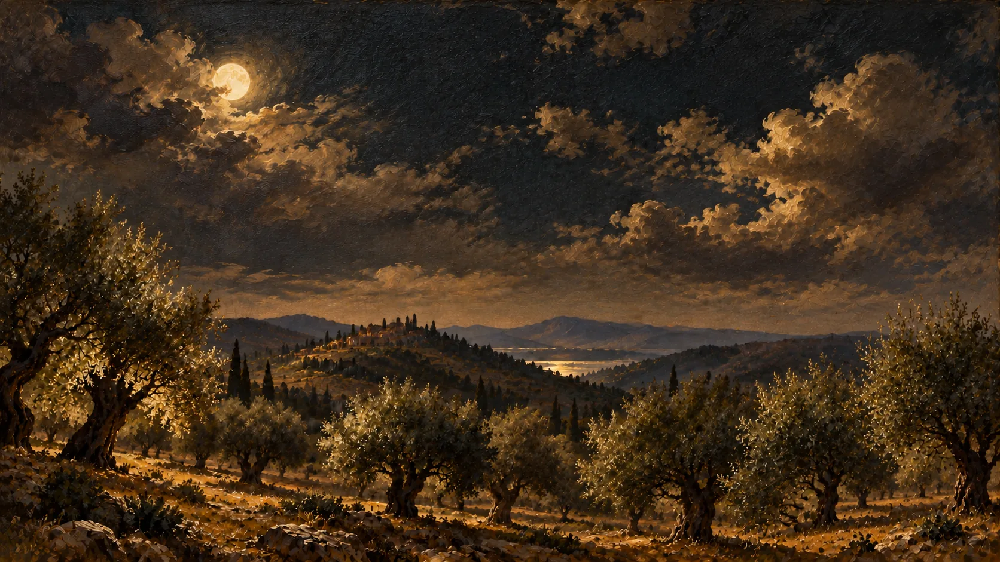

# VESPRA

VESPRA is a fictional olive oil brand created for a Peakvision website concept. The page follows one olive through seven chapters, from the grove to the finished bottle.



[View the live concept](https://levyschools-arch.github.io/vespra-olive-oil/).

The site uses illustrated scenes, scroll animation and a glass bottle drawn in Three.js. It is a static site built with HTML, CSS and JavaScript. GSAP controls the chapter motion. The bottle is made in code rather than loaded as a 3D model.

## View locally

Serve the repository with a local static server, then open the address it gives you. For example:

```sh
python3 -m http.server 8000
```

Open `http://localhost:8000` in a browser. A network connection is needed for the libraries and fonts loaded from external sources.

This is a concept project, not a real olive oil business. [See Peakvision](https://peakvision.digital/) for website work.
